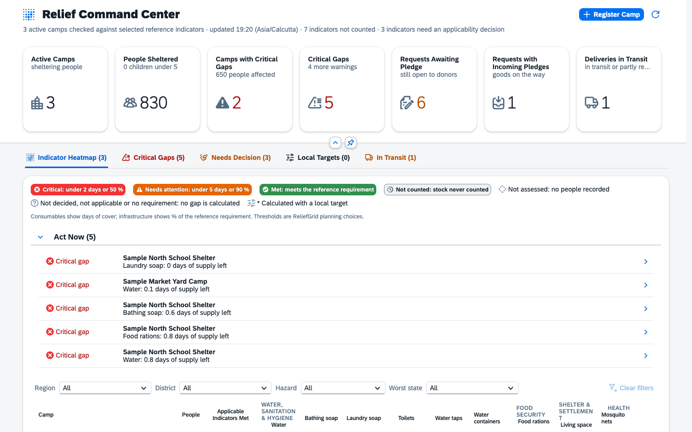
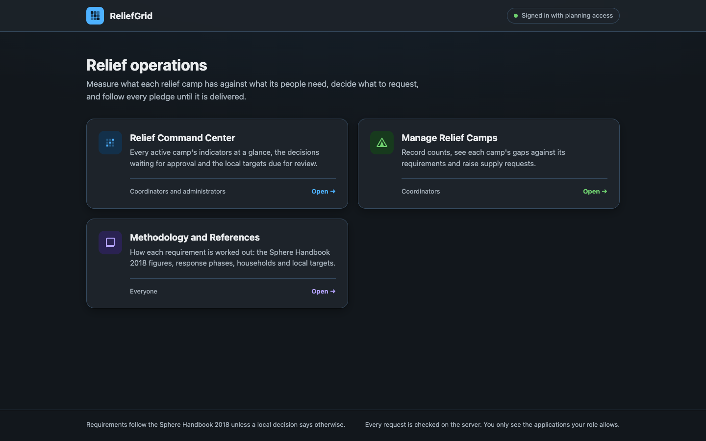
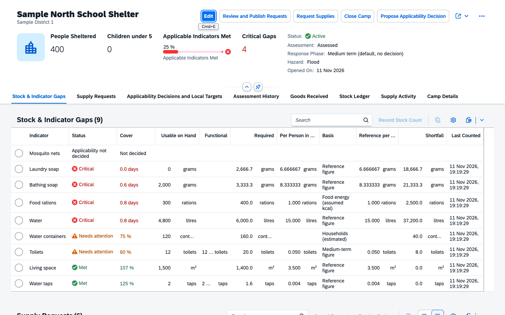
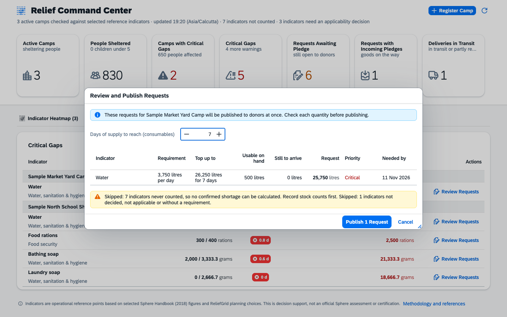
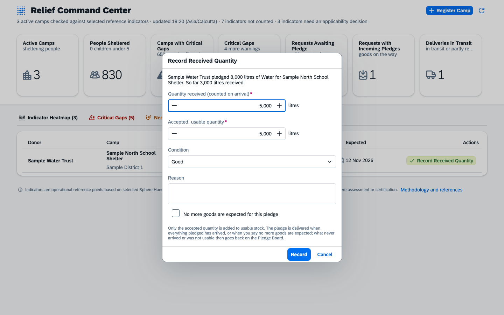
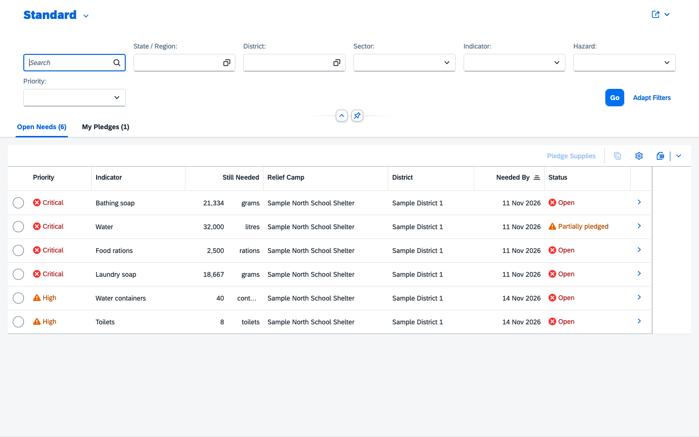
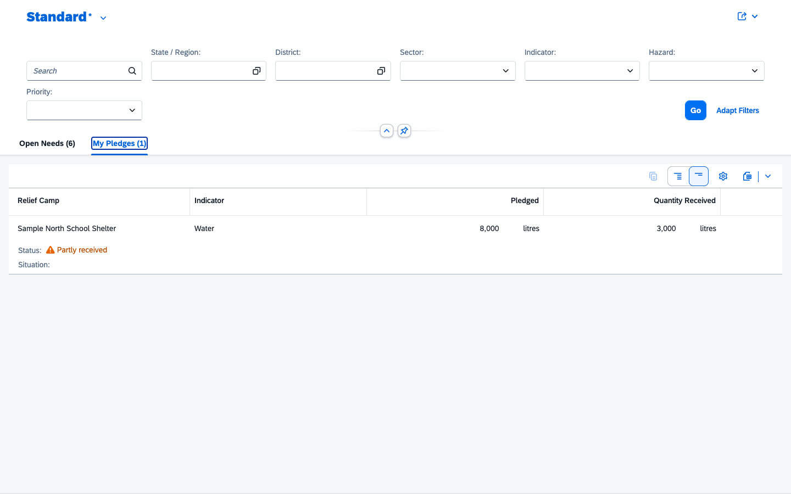
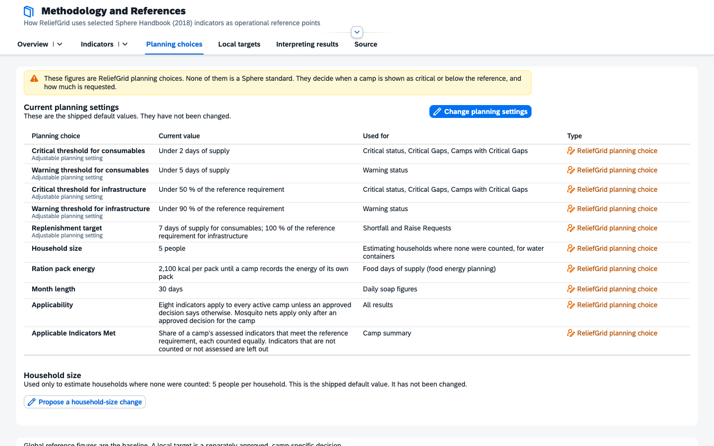
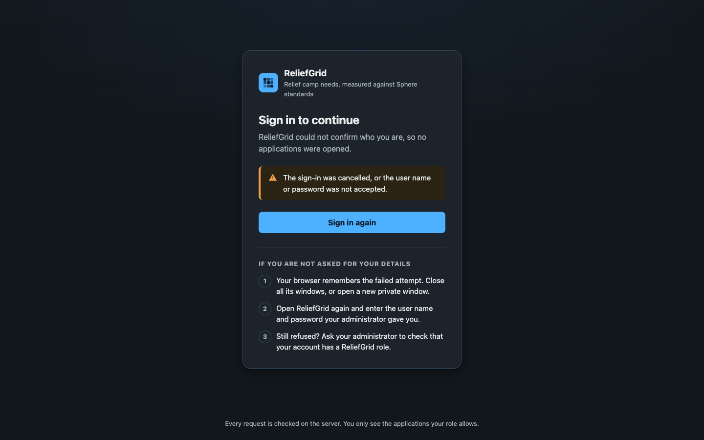
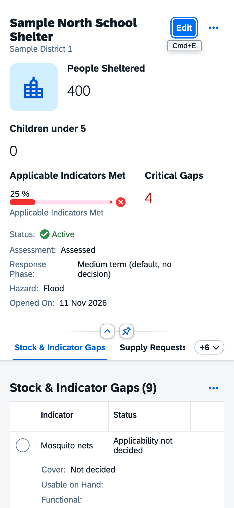

# ReliefGrid

ReliefGrid is a decision-support application for relief camps. It compares what each camp has in stock with what its people need, using selected indicators from the Sphere Handbook (2018) and clearly labelled ReliefGrid planning choices. It turns confirmed shortages into supply requests, lets known donor organisations pledge against them, and records what actually arrives.

It is built for district control rooms and camp coordinators who need to see, across many camps, where people will run out of water, food, hygiene items or sanitation first, and to act on it with a full audit trail.

ReliefGrid is decision support, not an official Sphere assessment or certification. Every figure it uses is cited, and every figure that is a ReliefGrid assumption is labelled as one.



## Contents

1. [Core capabilities](#core-capabilities)
2. [Screenshots](#screenshots)
3. [User roles and permissions](#user-roles-and-permissions)
4. [Core workflows](#core-workflows)
5. [System architecture](#system-architecture)
6. [Technology stack](#technology-stack)
7. [Database design](#database-design)
8. [Security and governance](#security-and-governance)
9. [Installation and setup](#installation-and-setup)
10. [Environment configuration](#environment-configuration)
11. [Database setup, migrations and backups](#database-setup-migrations-and-backups)
12. [Testing](#testing)
13. [Deployment](#deployment)
14. [Live application](#live-application)
15. [Repository structure](#repository-structure)
16. [Known limitations](#known-limitations)
17. [Future development](#future-development)
18. [License](#license)

## Core capabilities

**Camp and population management**
- Camp registration with location, hazard, population and children under five; draft editing with Fiori elements.
- Households counted per camp, or estimated from the headcount and a household-size planning assumption; an estimate is always labelled as one.
- A camp with counts, requests or decisions is closed, never deleted; only an untouched camp can be deleted, and the deletion is audited.

**Stock, indicators and assessment**
- Nine indicators: water, food rations, bathing and laundry soap, living space, toilets, water taps, water containers and mosquito nets.
- Each line is classified as Critical, Needs attention or Met, or explicitly as Not assessed, Not counted, Applicability not decided, Not applicable, Requirement not established, or Functionality not confirmed. Nothing unknown is ever shown as met.
- Thresholds and the replenishment target are adjustable planning settings, changed only by an Administrator with a reason.
- Toilets and taps are counted as total and functional units; only functional units meet the requirement (B4.5).
- Toilet figures follow the camp's response phase: first phase of a rapid-onset crisis (1 per 50 people) or medium term (1 per 20) (B4.4).
- Food is planned by energy: each camp records the kcal of its ration pack; days of cover = (packs × kcal per pack) ÷ (people × 2,100) (B5).
- Every assessment is kept as an append-only record of its inputs and results, so any past state can be explained.

**Decisions and governance**
- Applicability decisions, camp-specific local targets and response-phase decisions, each proposed with a reason and approved by a different Administrator, with effective and review dates.
- Household-size changes are proposed by one Administrator and approved by another.
- When a decision or a household figure changes the requirement of an outstanding request, the request is flagged for review with the reason in words; its quantity, pledges and deliveries are never changed automatically.

**Requests, pledges and deliveries**
- Review and Publish Requests: a preview shows each request (need, target, usable stock, goods still to arrive, quantity, priority, needed-by date) before anything is published to donors.
- Known donor organisations pledge against open needs and see their own pledges, including what happened to them when a camp closed or a request was cancelled.
- Goods are recorded as they arrive, in one or several shipments, with received and accepted (usable) quantity and condition. Damaged or rejected goods, more than pledged, and closing a pledge early all need a reason. Late deliveries to a closed camp are recorded and marked.

**Operational visibility**
- Relief Command Center: KPIs with their exact rules, an Act Now list (critical gaps by time to stock-out, overdue deliveries, unanswered requests), an indicator heatmap grouped by sector with region, district, hazard and severity filters, critical gaps, decisions needing attention, local targets and deliveries in transit.
- Per camp: stock and gaps, supply requests, decisions, assessment history, goods received, the stock ledger and the supply audit trail.
- Methodology and References: every indicator with its Sphere citation (chapter, standard, page and quotation), what ReliefGrid derives from it, and every planning choice.

## Screenshots

All screenshots are of the final application running locally with clearly labelled sample data.

| | |
| --- | --- |
|  Home: the applications each signed-in user may open |  Camp page: stock and indicator gaps |
|  Review and publish requests |  Recording a delivery |
|  Pledge Board for donors |  A donor's own pledges |
|  Planning choices and household-size governance |  Sign-in needed |



## User roles and permissions

| Role | Can | Cannot |
| --- | --- | --- |
| **Coordinator** | Register and edit camps, record stock counts and functional units, raise and cancel requests, record deliveries, close pledges, propose applicability decisions, local targets and response phases, review flagged requests | Approve anything, change planning settings or the household size, use the Pledge Board |
| **Administrator** (together with Coordinator) | Everything a Coordinator can, plus approve or reject proposals made by someone else, record decision reviews, change planning settings, propose and approve household-size changes | Approve a proposal they made themselves |
| **Donor** | See open needs, pledge supplies, see their own pledges | See camps, stock, contacts, other donors' contacts or any coordinator data |
| Signed-in user without a role | Read the methodology | Use any operational application |

Every permission is enforced in the services; the user interface only hides what the service would refuse.

## Core workflows

1. **Register a camp.** A coordinator creates the camp and records its population; stock lines are created for every indicator and the camp is assessed.
2. **Count stock.** Each count is recorded with a timestamp and a stock-ledger movement; toilets and taps also record functional units.
3. **Decide where needed.** Mosquito nets apply only after an approved applicability decision; any indicator can get a local target; toilets follow the camp's response phase. Each decision needs a second person.
4. **Review and publish requests.** The coordinator previews the requests for the configured days of supply and publishes them; lines not counted, not decided or not confirmed are listed as skipped, never requested.
5. **Pledge.** Donors pledge against open needs; per-account limits keep one account from blocking the board.
6. **Receive goods.** Each arrival is recorded with received and accepted quantity and condition; only accepted goods raise usable stock. The pledge is delivered when everything arrived or the coordinator closes it.
7. **React to change.** When a decision or a household figure changes a requirement, outstanding requests are flagged for review with the reason; donors no longer see them until a coordinator keeps or cancels them.

## System architecture

```
Browser ── SAPUI5 1.148 (CDN)
  ├─ Home page (app/index.html)            plain HTML; asks AccessService which apps to show
  ├─ Relief Command Center (app/command)    freestyle SAPUI5
  ├─ Manage Relief Camps   (app/camps)      Fiori elements V4 (List Report, Object Page) + small extensions
  ├─ Pledge Board          (app/pledge)     Fiori elements V4
  └─ Methodology           (app/methodology) freestyle SAPUI5
        │  OData V4
Node.js ── SAP Cloud Application Programming Model (CAP)
  ├─ ReliefService  /odata/v4/relief   role Coordinator (some actions Administrator)
  ├─ DonorService   /odata/v4/donor    role Donor
  ├─ AccessService  /odata/v4/access   any signed-in user (which apps to show)
  ├─ srv/lib        domain logic: assessment, decisions, households, supply, ledger, clock, planning
  └─ server.js      start-up checks, schema evolution, security headers, /health and /ready
        │
Database ── SQLite (self-hosted, development, tests)  |  SAP HANA Cloud (SAP BTP, compiled)
```

Gap metrics are calculated elements in the database model, so lists filter and sort on them. All business rules run in the service handlers; there are no client-side permission checks.

## Technology stack

| Layer | Technology |
| --- | --- |
| Runtime | Node.js 22.5 or later (uses the built-in `node:sqlite`) |
| Framework | SAP Cloud Application Programming Model, `@sap/cds` 10.2 |
| Database | SQLite through `@cap-js/sqlite` 3; SAP HANA through `@cap-js/hana` 3 (compiled, see limitations) |
| UI | SAPUI5 1.148.12 from the SAP CDN; SAP Fiori elements V4; SAP Horizon theme |
| Protocol | OData V4 |
| Authentication | HTTP basic (self-hosted); XSUAA with an approuter (SAP BTP) |
| Tests | Node.js test runner with `@cap-js/cds-test`; Puppeteer (`puppeteer-core` 25) with Chrome; QUnit |
| Delivery | Docker (self-hosted), Render blueprint, MTA for SAP BTP Cloud Foundry; GitHub Actions CI |

## Database design

Key entities (`db/schema.cds`):

| Entity | Purpose |
| --- | --- |
| `Camps` | Camp master data, population, recorded households, ration pack energy |
| `Stock` | One line per camp and indicator; the classification, requirement, cover and shortfall are calculated elements |
| `Standards`, `Sectors` | Reference indicators with Sphere citations, phase figures, functional counting and food energy |
| `CampDecisions`, `DecisionReviews` | Applicability, local target and response-phase decisions with approval and periodic review |
| `Requests`, `Pledges`, `DeliveryReceipts` | Requests with their calculation basis; pledges; every arrival of goods |
| `RequestReviews` | Reviews of requests flagged by a decision or a household change |
| `AssessmentRecords`, `AssessmentRecordLines` | Append-only history of every assessment, with all inputs |
| `StockMovements`, `AuditEvents` | Append-only stock ledger and supply audit trail |
| `PlanningSettings`, `HouseholdAssumption` and their change and proposal histories | Planning choices and their governance |

**Migrations.** For a file-based SQLite database the schema is evolved on start-up without dropping data (`cds deploy` with `schema_evolution: auto`); reference data is upserted from `db/data`. New tables start empty: nothing is reconstructed for past events. A change of reference figures writes one explained assessment record per active camp. Each release was verified with an upgrade of a database written by the previous accepted release, and a rollback rehearsal (the earlier code refuses to start on the upgraded database and leaves it untouched; restoring the backup works).

## Security and governance

- **Authentication:** basic authentication over HTTPS (self-hosted) or XSUAA (SAP BTP). Development and test authentication is refused on any non-loopback address.
- **Authorisation:** role checks on every service, entity and action; donors see an explicit allow-list of fields; the donor role is a controlled list of organisations.
- **Two-person rule:** decisions and household-size changes are approved by someone other than the proposer; simultaneous actions produce exactly one result (compare-and-set with versions and ETags).
- **Audit:** append-only assessment history, decision and review history, household and settings change logs, request reviews, stock ledger and supply audit events.
- **Data integrity:** request, pledge and camp operations lock the rows they depend on; a failed operation writes nothing.
- **HTTP hardening:** Content Security Policy, `X-Content-Type-Options`, `X-Frame-Options`, `Referrer-Policy`, `Permissions-Policy`, HSTS on HTTPS; QUnit test pages are not served outside development and test and are not in the Docker image.
- **Abuse limits:** configurable caps on open pledges per donor account and pledges per hour; coordinators can withdraw all open pledges of one account.

Details: [docs/SECURITY_AUDIT.md](docs/SECURITY_AUDIT.md).

## Installation and setup

Prerequisites: Node.js 22.5 or later, and Google Chrome for the browser tests.

```bash
git clone https://github.com/AswarthaHarshitha/reliefgrid.git
cd reliefgrid
npm ci
npm run watch          # http://localhost:4004
```

In development, the database is a local SQLite file (`reliefgrid.sqlite`, created on first start, not committed) and sign-in accepts any user name with every role. The development server binds to `localhost` only and refuses to start on another address with development authentication.

## Environment configuration

| Variable | Used for | Example |
| --- | --- | --- |
| `CDS_ENV` | Profile: `selfhost` for the container | `selfhost` |
| `NODE_ENV` | `production` in the container | `production` |
| `CDS_REQUIRES_DB_KIND`, `CDS_REQUIRES_AUTH_KIND` | Keep the container on SQLite and basic auth (set in the Dockerfile) | `sqlite`, `basic` |
| `CDS_CONFIG` | **Secret.** User accounts and roles for basic authentication, as JSON | see below |
| `RELIEFGRID_TIME_ZONE` | Operation time zone for due, overdue and needed-by dates (IANA name); default UTC | `Asia/Kolkata` |
| `HOST`, `PORT` | Listen address and port | `0.0.0.0`, `4004` |

`CDS_CONFIG` format (never commit real values):

```json
{"requires":{"auth":{"users":{
  "<user>": {"password": "<strong password>", "roles": ["Coordinator", "Administrator"]},
  "<donor organisation>": {"password": "<strong password>", "roles": ["Donor"]}
}}}}
```

Pledge limits are set in `package.json` under `cds.reliefgrid.pledges` (`maxOpenPerDonor`, `maxPerHour`).

## Database setup, migrations and backups

- **First start:** the schema and reference data are created automatically; no business data is created.
- **Upgrade:** take a backup, then start the new version; the schema evolves in place. A newer database is refused by older code, so roll back by restoring the backup.
- **Backup:** `npm run backup -- <database file> <backup directory>` writes a consistent copy with `VACUUM INTO` (safe while the server runs), checks its integrity and row counts, and writes a SHA-256 manifest. In the container: `node scripts/backup-database.js /data/reliefgrid.sqlite /data/backups`.

## Testing

```bash
npm test               # domain, service, security, migration and concurrency tests (in-memory SQLite)
npm run test:ui        # browser tests in headless Chrome, each against an isolated in-memory server
npm run build          # production build, including SAP HANA artefacts
```

Results on the released source (Node.js test runner and Puppeteer):

| Suite | Result |
| --- | --- |
| `npm test` | 387 of 387 tests passed |
| `npm run test:ui` | smoke 187, overdue reviews 24, local targets 40, households 24, response phase 10, functional counts 8 checks passed; QUnit 94 of 94 and 20 of 20; no console or page errors |
| Mutation checks (per stage) | each stage's rules were changed one at a time to confirm the tests fail; surviving mutants are documented as equivalent in the stage records |
| Upgrade and rollback | verified on a database written by the previous accepted release (70 checks) |

The browser tests set `CHROME_PATH` if Chrome is not in its default location.

## Deployment

**Self-hosted container (Docker).** The image runs the `selfhost` profile with SQLite on the `/data` volume and basic authentication. Put it behind HTTPS.

```bash
docker build -t reliefgrid .
docker run -p 4004:4004 -v reliefgrid-data:/data -e CDS_CONFIG='<user accounts JSON>' reliefgrid
```

**Render.** `render.yaml` describes the same container with a persistent disk, `/ready` as the health check and `CDS_CONFIG` as a secret set in the dashboard. Step-by-step deployment, backup and verification: [docs/DEPLOYMENT.md](docs/DEPLOYMENT.md).

**SAP BTP, Cloud Foundry.** `mta.yaml` builds the service for SAP HANA Cloud with XSUAA and an approuter (`mbt build`, `cf deploy`). Role collections are created but assigned to nobody.

CI (`.github/workflows/ci.yml`) runs the tests, the browser tests, the production build and a Docker image build on every push.

## Live application

The production URL is recorded here once the deployment has been verified: **pending**.

## Repository structure

```
app/            the user interfaces (one folder per app), the home and sign-in pages, shared modules
db/             the data model (schema.cds) and reference data (db/data)
srv/            OData services and their handlers; domain logic in srv/lib
scripts/        operational scripts (database backup)
test/           service tests; test/ui browser tests; test/helpers test-only accounts
docs/           audits, stage records, deployment guide, screenshots
approuter/      SAP BTP approuter
server.js       start-up checks, schema evolution, HTTP hardening, health endpoints
Dockerfile, render.yaml, mta.yaml, xs-security.json   deployment descriptors
```

## Known limitations

- SAP HANA: the model compiles to HANA without warnings, but no HANA runtime test has been run; row locking under parallel transactions is verified on SQLite only.
- Sign-in for the self-hosted container is HTTP basic authentication with accounts in an environment variable; there is no password policy, lockout or single sign-on. A wider deployment needs an identity provider.
- Indicator coverage is limited to nine indicators; energy alone does not show that food meets protein, fat or micronutrient needs.
- There is no stale-count threshold: old counts are shown with their date but never marked stale (a planning decision).
- The Command Center reads up to 1,000 active camps at once and says so when there are more.

## Future development

Planned, not implemented: an identity provider for self-hosted deployments, HANA runtime verification with parallel-transaction tests, additional indicators agreed with the domain owner, and offline-capable stock counting for camps with poor connectivity.

## License

MIT, see [LICENSE](LICENSE).
